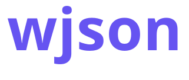

<div align="center">



<hr>

**JSON for the Wave language.**

Strict parsing, safe paths, editing in place and streaming for files of any size.

[Guide](docs/GUIDE.md) · [API](docs/API.md) · [Examples](examples) · [Building](docs/BUILDING.md) · [Changelog](CHANGELOG.md)

[](https://github.com/potatosl/wjson/actions/workflows/ci.yml) [](LICENSE) [](https://wave-lang.dev)

**English** | [한국어](README.ko.md)

</div>

It reads and writes JSON, lets you look values up with paths that never crash, edits documents in place,
and streams files that do not fit in memory. The parser is strict RFC 8259 with a depth limit, and
comments or trailing commas can be switched on for config files. It has no dependencies, and on Windows it
needs no MSVC or Visual Studio.

## A taste

```wave
import("wjson")::{JsonDoc, Json, json_parse, json_ok, json_root, json_path_str,
                  json_path_i64, json_free};

fun main() {
    var doc: JsonDoc = json_parse("{\"server\": {\"host\": \"0.0.0.0\", \"ports\": [8080, 8443]}}");
    if (!json_ok(doc)) { return; }
    var cfg: Json = json_root(doc);
    println("{}:{}", json_path_str(cfg, "server.host", "localhost"),
                     json_path_i64(cfg, "server.ports[0]", 80));     // 0.0.0.0:8080
    json_free(&doc);
}
```

Paths such as `"server.ports[0]"` take a default, so a missing key or a wrong type gives you the default
instead of a crash. Writing and editing look like this:

```wave
var doc: JsonDoc = json_parse("{\"name\": \"wave\", \"tags\": []}");
var root: Json = json_root(doc);
json_set_str(root, "name", "wjson");               // replace a value
json_set_path_i64(root, "limits.depth", 512);      // intermediate objects are created
json_push_str(json_get(root, "tags"), "json");     // append to an array
```

## What is in it

- **Parsing**: strict RFC 8259, a depth limit (512 by default), optional comments and trailing commas,
  exact error positions.
- **Reading**: typed accessors with defaults, JSON Pointer, dotted paths, safe chains.
- **Writing**: a writer that keeps commas and nesting right, pretty printing, ASCII or HTML-safe escaping.
- **Editing**: set, insert, replace, remove and copy values, by key or by path.
- **Streaming**: constant memory for any file size, JSON Lines, the same grammar and error positions as the
  full parser.
- **Numbers**: correctly rounded parsing and the shortest text that round-trips.
- **C and C++**: the same core is available through `wjson.h` and a header-only `wjson.hpp`.

## How it is built

Wave, Rust and C++ each do the part they are best at. The API, and a complete parser, document model,
editor and streaming reader, are Wave. The same parser also exists in Rust, which serves C and C++ users
and is the reference the Wave code is tested against (fuzzing compares the two). Number conversion and string
escaping are written twice as well, in Wave and in freestanding C++. On Windows a small Rust linker
(`wjlink`) replaces MSVC. There are no external crates or libraries. See
[Architecture](docs/ARCHITECTURE.md).

## Platforms

CI builds and runs the whole test suite on every push on Linux (x64, ARM64), Windows (x64, ARM64) and
macOS (Apple silicon, Intel).

## Get started

You need the [Wave compiler](https://wave-lang.dev/docs/en/getting-started/install) (`wavec`) and a C++20
compiler. On Linux and macOS the installer builds wjson and writes a wrapper that compiles your program
against it (read the script first, it is short):

```sh
curl -fsSL https://raw.githubusercontent.com/potatosl/wjson/main/install.sh | sh
~/.wjson/bin/wjson-wavec hello.wave --run
```

On Windows, double-click `setup-windows.cmd` in a clone; it installs what is missing and runs the tests.
Doing it by hand, linking the libraries yourself, using wjson from C or C++, and `vex` are in
[Installing, building and testing](docs/BUILDING.md).

## Learn more

- [Guide](docs/GUIDE.md): parsing, writing, editing and streaming by example, and the memory rules.
- [API overview](docs/API.md): the Wave API by area.
- [Architecture and limitations](docs/ARCHITECTURE.md).
- [Installing, building and testing](docs/BUILDING.md), with benchmarks and Windows without MSVC.
- [Changelog](CHANGELOG.md), [contributing](CONTRIBUTING.md) and [security](SECURITY.md).
- `examples/`: reading a config with comments, editing it, streaming rows, converting a CSV.

## Status

wjson is at 0.x and Wave itself is pre-beta, so the API may still change in minor releases. The parser
and the number code have been fuzzed against independent references.

## License

[MPL-2.0](LICENSE). Copyright (c) 2026 potatosl and the wjson contributors. Modified copies of the files in
this repository must stay under the MPL-2.0; programs that merely use wjson may use any license.

<p align="center">
  <a href="https://wave-lang.dev"></a>
</p>
